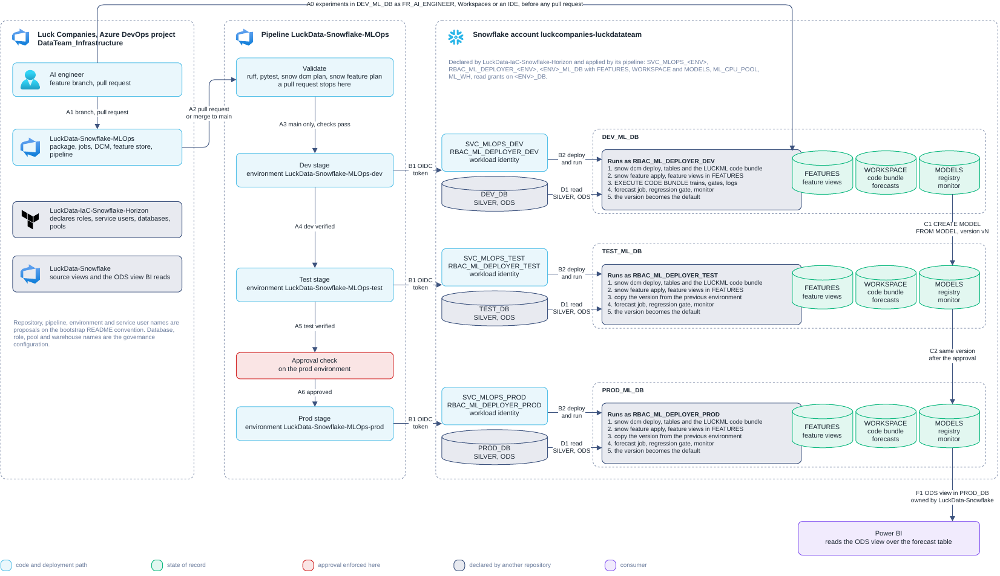

# LuckData-Snowflake-MLOps

The monthly site tonnes forecast as code on Snowflake. A small Python package trains a LightGBM model on a feature view, logs the version to the Model Registry, writes a batch forecast and creates a monitor. One Azure DevOps pipeline moves the same version from dev to test to prod, each environment under its own identity, prod behind an approval. The platform objects it runs on (databases, roles, service users, compute pool, warehouse) are declared in `LuckData-IaC-Snowflake-Horizon`; this repository never creates them.



## Lifecycle

1. **Experiment in dev.** An AI engineer works directly in `DEV_ML_DB` as `FR_AI_ENGINEER`, from a Workspace notebook or an IDE, and logs as many versions as the work needs. Nothing here touches `main`.
2. **Pull request.** The candidate's code goes on a branch. The branch policy runs the `Validate` stage: `ruff`, `pytest`, `snow dcm plan` and `snow feature plan` against dev, signed in as `SVC_MLOPS_DEV`.
3. **Main, dev.** The merge runs `Validate` again, then the `Dev` stage deploys the schema objects and feature views, copies the code to a stage, trains as a Snowflake ML Job on `ML_CPU_POOL`, gates on MAPE, logs version `V<build>` to `DEV_ML_DB.MODELS`, writes the forecast, refreshes the actuals, passes the regression gate against the current default, verifies, creates the monitor and sets the version as dev's default.
4. **Test.** Receives the same version with `CREATE MODEL ... FROM MODEL`, never a retrain, then forecasts, refreshes the actuals, passes the regression gate, verifies, monitors and sets the default on `TEST_ML_DB`.
5. **Prod.** After the approval on the `LuckData-Snowflake-MLOps-prod` environment, the same version is copied into `PROD_ML_DB` and goes through the same steps. The default version in prod is what production code calls, and it moves only after the candidate passed the regression gate there.

`docs/architecture.md` walks the diagram journey by journey.

## Layout

```
azure-pipelines.yml            Validate, Dev, Test, Prod (approval)
pipelines/templates/           tools.yml (Python environment), snow-step.yml (signed-in step), deploy-env.yml (the six steps per environment)
src/luckml/                    config, session, data, features, model, registry, forecast, submit
jobs/                          train.py and forecast.py, the ML Job entry points
dcm/                           DCM project: WORKSPACE view, tables and stage, one target per environment
features/                      declarative feature store: SITE entity, SITE_MONTH_LAGS source, SITE_MONTHLY_TONNES view
config/                        dev.yml, test.yml, prod.yml
scripts/                       promote.sql, actuals.sql, regression.sql, verify.sql, monitor.sql, set_default.sql
tests/                         unit tests, no Snowflake connection needed
bootstrap/README.md            what to create in Azure DevOps and Snowflake before the first run
docs/architecture.md           the diagram explained
CONTRIBUTING.md                how a change is made and reaches an environment
features/README.md             the feature store project
img/                           the lifecycle diagram, editable in draw.io
```

## Local run

```bash
python3.12 -m venv .venv && .venv/bin/pip install -r requirements-dev.txt -e .
snow connection add                      # a connection for your user, role FR_AI_ENGINEER
export SNOWFLAKE_CONNECTION_NAME=<name>
export SNOWFLAKE_CLI_FEATURES_ENABLE_FEATURE_STORE=true

.venv/bin/pytest -q && .venv/bin/ruff check .
(cd dcm && snow dcm plan -c <name> --target dev)
(cd features && snow feature plan -c <name> --database DEV_ML_DB --schema FEATURES --target dev)

for d in src/luckml jobs config; do snow stage copy -c <name> $d @DEV_ML_DB.WORKSPACE.CODE/local/$d --recursive --overwrite; done
.venv/bin/python -m luckml.submit --env dev --job train --version VLOCAL --run-id local --build-dir local
.venv/bin/python -m luckml.submit --env dev --job forecast --version VLOCAL --run-id local --build-dir local
```

`snow stage copy --overwrite` can leave an unchanged-size file in place; remove the folder on the stage before copying when a local change does not show up in a job.

## Pipeline variables

Set on the pipeline definition, not in the YAML, so the file is the same everywhere.

| Variable | Value |
|---|---|
| `serviceConnectionDev`, `serviceConnectionTest`, `serviceConnectionProd` | the three service connections, one managed identity each |
| `snowflakeAccount` | the account identifier, `<org>-<account>`, the one the targets in `dcm/manifest.yml` and `features/manifest.yml` name |
| `agentPool` | the Linux agent pool that runs the pipeline, Python 3.12 on the agents |

## Bootstrap

`bootstrap/README.md` lists what has to exist before the first run, in order.

## What the production model adds

This repository carries the pattern on a deliberately small model. The production forecast brings its own feature views and training code into the same places (`features/`, `src/luckml/`, `jobs/`), a task graph in `WORKSPACE` so the forecast runs monthly without a pipeline run, the ODS view that reporting reads over `WORKSPACE.FORECAST_SITE_MONTH` (declared in `LuckData-Snowflake`), and a scheduled retrain that registers a candidate in test for a person to promote.

## Versions

`requirements.in` holds the floors, `requirements.txt` the exact versions resolved from them. To move to the latest usable set, resolve again and let `Validate` prove it:

```bash
uv pip compile --upgrade --python-version 3.12 requirements.in -o requirements.txt
uv pip compile --upgrade --python-version 3.12 requirements-dev.in -o requirements-dev.txt
```

`lightgbm` is pinned to the version the Snowflake container runtime ships, so a model logged inside a job is the same library locally.
