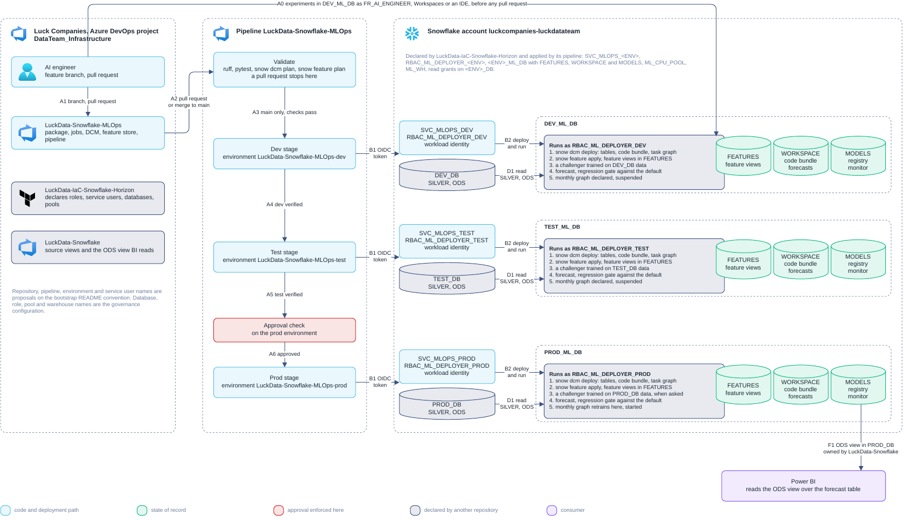
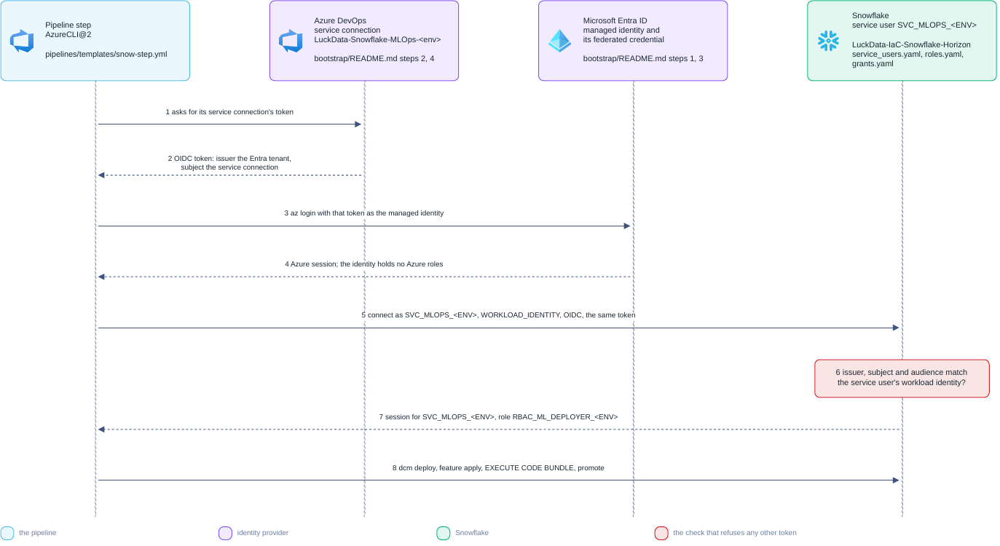
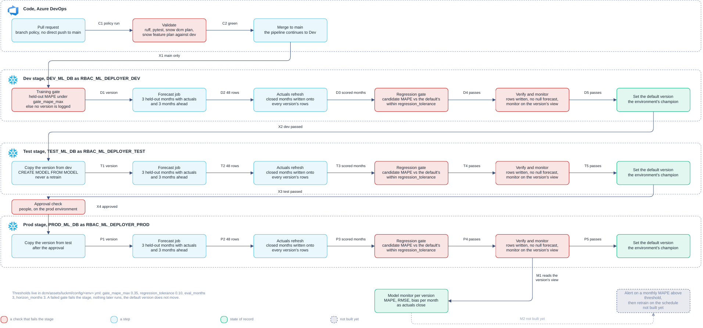

# Architecture



Three repositories share the work. `LuckData-IaC-Snowflake-Horizon` declares the identities, databases, roles, pool and warehouse. `LuckData-Snowflake` deploys the source views the model reads and the ODS view reporting consumes. This repository deploys the model's own objects and its code; each environment trains its own model from that code. The journeys below are the numbered arrows on the diagram.

## A0, experiments

The AI engineer signs in to Snowsight as `FR_AI_ENGINEER`, which holds admin on `DEV_ML_DB.FEATURES`, `WORKSPACE` and `MODELS`, and works in a Workspace notebook or an IDE against the dev feature view. Versions logged this way live in `DEV_ML_DB.MODELS` beside the pipeline's and never leave dev. The same role has read only on test and prod.

## A1 to A6, code to prod

A branch and a pull request (A1) run `Validate` through the branch policy on `main`: lint, unit tests, `snow dcm plan` and `snow feature plan` as `SVC_MLOPS_DEV` (A2). A merge to `main` runs `Validate` again and continues (A3) to `Dev`, then `Test` when dev verified (A4), then the approval check on the prod environment (A5) and `Prod` (A6). A pull request run stops after `Validate`.

## B1 and B2, one identity per environment



Each stage is a deployment job on its own Azure DevOps environment and signs in through its own service connection. The connection's federated token (B1) is presented to Snowflake as `SVC_MLOPS_<ENV>`, a service user that holds `RBAC_ML_DEPLOYER_<ENV>` and nothing else. No key pair, no secret, nothing to rotate. The dev identity cannot read `TEST_ML_DB`; the boundary proof below shows the refusal.

Under that role the stage runs the same steps in every environment (B2): `snow dcm deploy` for the `WORKSPACE` view, tables, stage, code bundle and task graph; `snow feature apply` for the feature view in `FEATURES`; then four jobs of the code bundle on `ML_CPU_POOL`. `train` logs a challenger trained on that environment's data; `forecast` writes its rows; `gate` writes the closed months' actuals onto every version's rows and refuses a challenger whose MAPE on those months is worse than the current default's beyond a tolerance; `promote` verifies the rows, creates the version's monitor, makes it the default, and retires old versions when enabled. The SQL these jobs run lives in the bundle's `sql/` folder.

## Quality gates



Five checks stand between a change and the production default, and each one fails the stage it runs in. The pull request's `Validate` (lint, tests, DCM and feature store plans). The training gate, the held-out weighted error (`wape`, errors in tonnes over tonnes) under `gate_wape_max`, a loose ceiling that only refuses a broken model. The regression gate in every environment, the candidate's `wape` on the months with actuals against the current default version's, within `regression_tolerance`, the check that does the real work. The other metrics of the bake-off scorecard (bias, median and P90 error, RMSE, stockout and excess rates, the two naive baselines) are computed on the same rows and stored with the version; they inform and never block. The verify step, rows written, no null forecast, the version present. The approval on the prod environment. After them the version becomes the environment's default, and its monitor reports the error per month as the actuals refresh writes closed months onto its rows. The thresholds live in `dcm/assets/luckml/config/<env>.yml`.

## C1 and C2, what moves between environments

Code moves, models do not. Test (C1) and prod (C2) receive the reviewed code bundle and train their own challenger from it; no environment reads another's models. This is the deploy-code pattern: the code is what is reviewed and tested, and every production model is trained on production data by that code. The default version in prod is what production code calls, and it moves only when a challenger passed the regression gate in prod.

## M1, the monthly cycle

`<ENV>_ML_DB.WORKSPACE.MONTHLY_CYCLE` is a task graph declared by DCM in every environment, started only in prod (`cycle_state` in `dcm/manifest.yml`), on `cycle_schedule`, the third of the month at 06:00 by default. One run:

1. `MONTHLY_START`, the root.
2. `MONTHLY_FORECAST_DEFAULT`, after the root: the current default forecasts the months ahead, so the month always has a forecast.
3. `MONTHLY_TRAIN`, after the root: a challenger `M<yyyymmddhhmi>` trained on the latest data, the same name in every task of the run.
4. `MONTHLY_FORECAST_CHALLENGER`, `MONTHLY_GATE`, `MONTHLY_PROMOTE`, in that order, the same jobs the pipeline runs.

A failing task stops the tasks after it; the champion stays the default. The schedule assumes the previous month is complete in `<ENV>_DB.ODS.FCT_SITE_MONTH` by then; confirm the close date with the data team and move `cycle_schedule` if needed. The actuals refresh is idempotent, so a month that closes late is picked up by the next run. Task history is in Snowsight under Monitoring, Task History, and in `RUN_LOG`.

## D1, the data

Each `<ENV>_ML_DB.WORKSPACE.SRC_SITE_MONTH` view reads `<ENV>_DB.ODS.FCT_SITE_MONTH` through the `SILVER_R` and `ODS_R` database roles. The feature view computes the lags over it.

## F1, consumption

Reporting reads an ODS view in `PROD_DB` over `PROD_ML_DB.WORKSPACE.FORECAST_SITE_MONTH`, declared and deployed by `LuckData-Snowflake`, so a model change never reaches a report without passing the three environments.

## Boundary proof

The dev deployer role against the test database, as recorded on the first run:

```
select count(*) from TEST_ML_DB.WORKSPACE.FORECAST_SITE_MONTH
select count(*) from TEST_ML_DB.WORKSPACE.FORECAST_SITE_MONTH
002003 (02000): 01c7e095-0003-18b4-0003-b95e0020fb3e: SQL compilation error:
Database 'TEST_ML_DB' does not exist or not authorized. Your primary role
RBAC_ML_DEPLOYER_DEV must have USAGE or any other privilege granted on
DATABASE TEST_ML_DB.
```
